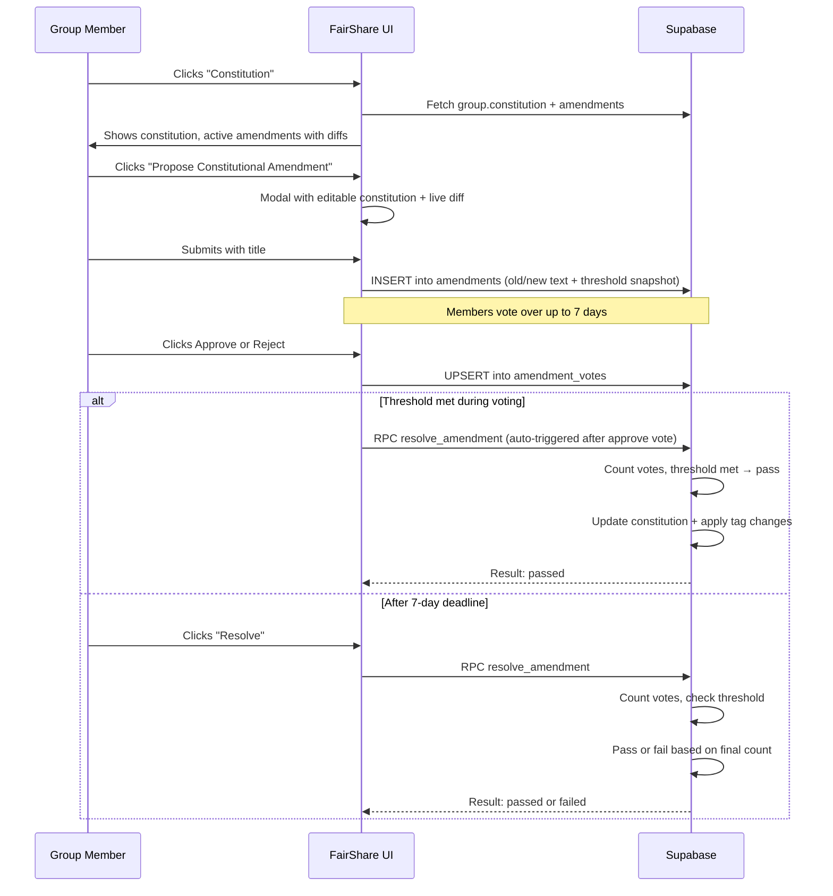

# Group Constitution and Amendment System

## Overview

Each group has a text constitution with machine-readable tagged variables. Any active member can propose constitutional amendments and can also create proposals that may become accords. Both vote flows run over a 7-day period by default (or `$VOTING_PERIOD_DAYS` when present), and each has a configurable approval threshold. When an amendment passes, tagged variable changes are automatically applied to the group's settings. Amendment and accord proposal history is preserved with full voting records.

## Constitution Format

The constitution is a rich plain text document stored in the `groups.constitution` column. `$IDENTIFIER` tags can appear anywhere in the text to link human-readable values to system variables. Each tagged value is the text between the nearest preceding colon and the `$TAG`:

```
We, the people, hereby give this Group Name: My Community $GROUP_NAME

In economic matters, we choose the Currency Name: credits $CURRENCY_NAME, and the Currency Symbol: C $CURRENCY_SYMBOL, and to Change Currency Rates: 66% $CHANGE_CURRENCY_RATES_PERCENTAGE of member's vote is required.

To Approve New Member: 100% $NEW_MEMBER_PERCENTAGE of member's vote is required.

Any member may delegate their vote to another member on these Issue Types: Membership, Monetary Policy $ISSUE_TYPES. A delegation may be withdrawn at any time.

Any member may propose amendment to this constitution. To Approve Amendment: 100% $AMENDMENT_PERCENTAGE of member's vote is required.

Any member may write a proposed accord. To Approve a proposed accord: 50% $ACCORD_PERCENTAGE of member's vote is required.

Voting will happen over a period of 3 days $VOTING_PERIOD_DAYS, with the percentage to approve being taken from the number of votes submitted.
```

When `$VOTING_PERIOD_DAYS` is present, percentage thresholds apply among members who voted during each round's window (not the full active membership). When the tag is omitted, thresholds use the full active membership (legacy behavior).

When an amendment changes a tagged value and passes, the `resolve_amendment` function uses a global regex (`:\s*([^:]*?)\s*\$([A-Z_]+)`) to find all tags and extract values, then applies changes to the corresponding database columns.

### Supported Tags

| Tag | Effect when changed |
|-----|-------------------|
| `$GROUP_NAME` | Updates `groups.name` |
| `$CURRENCY_NAME` | Updates `groups.currency_name` |
| `$CURRENCY_SYMBOL` | Updates `groups.currency_symbol` |
| `$NEW_MEMBER_PERCENTAGE` | Read at endorsement time from constitution text |
| `$AMENDMENT_PERCENTAGE` | Snapshot stored on each new amendment proposal |
| `$ACCORD_PERCENTAGE` | Snapshot stored on each new accord proposal (default 50%) |
| `$CHANGE_CURRENCY_RATES_PERCENTAGE` | Read at vote time by `compute_tally`; controls when enough members have voted to apply median fee rate / daily income (default 66%) |
| `$VOTING_PERIOD_DAYS` | When set (e.g. `3 days`), voting uses period-based denominators; amendment `expires_at` uses this many days; `finalize_expired_voting` closes expired rounds (client-triggered) |
| `$ISSUE_TYPES` | Comma-separated list of issue types members may delegate their vote on (default `Membership, Monetary Policy`). Read at vote time by `get_issue_types`; see [Vote Delegation](#vote-delegation-liquid-democracy) |

### Adding New Tags

The tag system is extensible. To add a new tag:

1. Add a `WHEN` clause to the `CASE` block in the `resolve_amendment` SQL function
2. Map the tag to the appropriate database column update
3. Add the tag to the default constitution in `createGroup()` in `fairshare/index.html`

Tags that don't map to a database column (like `$AMENDMENT_PERCENTAGE`) can be read directly from the constitution text at the point they're needed.

## Schema

### Constitution column on groups

```sql
alter table public.groups add column constitution text;
```

### Amendments table

```sql
create table public.amendments (
  id uuid primary key default gen_random_uuid(),
  group_id uuid not null references public.groups(id) on delete cascade,
  proposed_by uuid not null references public.profiles(id),
  title text not null,
  old_text text not null,       -- constitution snapshot at proposal time
  new_text text not null,       -- proposed new constitution
  status text not null default 'voting'
    check (status in ('voting', 'passed', 'failed', 'withdrawn')),
  threshold numeric not null,   -- snapshot of $AMENDMENT_PERCENTAGE (0-1)
  created_at timestamptz default now(),
  expires_at timestamptz default (now() + interval '7 days'),
  resolved_at timestamptz
);
```

### Amendment votes table

```sql
create table public.amendment_votes (
  id uuid primary key default gen_random_uuid(),
  amendment_id uuid not null references public.amendments(id) on delete cascade,
  user_id uuid not null references public.profiles(id),
  vote boolean not null,       -- true = approve, false = reject
  created_at timestamptz default now(),
  unique(amendment_id, user_id)
);
```

### Accord proposals table

```sql
create table public.accord_proposals (
  id uuid primary key default gen_random_uuid(),
  group_id uuid not null references public.groups(id) on delete cascade,
  proposed_by uuid not null references public.profiles(id),
  text text not null,
  status text not null default 'voting'
    check (status in ('voting', 'passed', 'failed', 'withdrawn')),
  threshold numeric not null,
  created_at timestamptz default now(),
  expires_at timestamptz default (now() + interval '7 days'),
  resolved_at timestamptz
);
```

### Accord votes table

```sql
create table public.accord_votes (
  id uuid primary key default gen_random_uuid(),
  accord_id uuid not null references public.accord_proposals(id) on delete cascade,
  user_id uuid not null references public.profiles(id),
  vote boolean not null,
  created_at timestamptz default now(),
  unique(accord_id, user_id)
);
```

## Resolution Logic

The `resolve_amendment` function (PostgreSQL, `SECURITY DEFINER`):

1. Verifies the amendment is in `voting` status and the caller is an active group member
2. Counts approval votes vs. active member count
3. If the threshold is met (approvals / active members ≥ threshold), the amendment passes immediately — even before the 7-day deadline
4. If the deadline has passed and the threshold is not met, the amendment fails
5. If the deadline hasn't passed and the threshold isn't met, voting continues (no resolution)
6. On pass: updates `groups.constitution`, parses `$TAG` values line by line, and applies changes via a `CASE` block
7. Sets `resolved_at = now()` and updates status to `passed` or `failed`

The `resolve_accord` function follows the same vote-window and threshold mechanics, but instead resolves text proposals in `accord_proposals` and logs `accord_passed` / `accord_failed` events without editing the constitution body.

## Vote Delegation (Liquid Democracy)

Schema and functions: `sql/vote-delegation-schema.sql`. Client: `js/delegation.js`.

Members can delegate their vote on any issue type declared by `$ISSUE_TYPES` to another active member, one delegate per issue type, and withdraw at any time. Delegations are transitive: if Bob delegates Membership to Carol and Carol delegates Membership to Dana, both Bob's and Carol's votes go to Dana.

| Issue type | Votes it covers |
|-----|-------------------|
| `Membership` | Candidate endorsements (`check_endorsements`) |
| `Monetary Policy` | Fee rate and daily income votes (`compute_tally`, weighted median) |
| Any other declared type | Accord proposals created with that `issue_type` (`resolve_accord`) |

Constitutional amendments are never delegated. If an amendment removes or renames an issue type, delegations for it stop counting (rows are kept; they count again if the type is restored).

**Counting.** `delegated_vote_weights(group, issue_type, voters)` gives every active member exactly one vote. A member who voted directly casts their own vote, overriding any delegation. Otherwise their vote follows the delegation chain to the first member who voted; if nobody on the chain voted, the vote isn't cast. On accords, approvers and rejecters both end chains, so delegated votes follow whichever side the delegate chose.

**Immediate effect.** Thresholds compare the weighted vote count with the share of all active members, so a change applies as soon as voting power passes the threshold, even mid-period. In particular, `claim_sponsorship`, `respond_to_group_invitation`, and `complete_meet` auto-endorse from the sponsor and call `check_endorsements`. If the sponsor holds enough Membership voting power, the new member is admitted when they create their account.

**Changing delegations.** `set_vote_delegation(group, issue_type, delegate)` validates the issue type against the constitution and then re-evaluates open votes for that issue type (pending candidates, open currency rounds, open accords), because a delegation can push one over its threshold. `withdraw_vote_delegation(group, issue_type)` deletes the row; withdrawing can only lower someone else's voting power, so nothing is re-evaluated. Delegations to or from a member are deleted when they stop being active.

**Privacy.** Who delegated to whom is visible only to the delegator: RLS on `vote_delegations` allows reading your own rows only, and `delegated_vote_weights` isn't callable by clients. Everyone else sees only aggregates from `get_voting_power` (members holding more than their own vote), `get_endorsement_tallies`, and `get_accord_tallies`. Delegation cycles are allowed rather than rejected, since a "this would create a loop" error would reveal other members' delegations. A loop that reaches no voter casts no votes; if anyone in the loop votes, the others' votes go to them.

**Members tab.** A member row shows `Membership: 4 votes · 40%` when votes are delegated to that member (green when that alone meets the threshold). It never shows whether or to whom a member delegated. The vote icon on a row opens the delegate dialog. "Your votes by issue type" at the top lists your own delegations with Withdraw buttons.

**Existing groups** without `$ISSUE_TYPES` can adopt delegation by amendment: the amendment dialog offers "+ Add vote delegation by issue type", which appends the default clause.

## User Interface

### Constitution View

Accessed via the "Constitution" button in the group action grid. Shows:

- Current constitution text with `$TAG` identifiers highlighted
- Accepted accords directly under the constitution in expandable blocks (proposer, text, voted-in date)
- "Propose Constitutional Amendment" button
- "Create Proposal" button
- Active amendments (status = `voting`) with:
  - Word-level redline diff (insertions in green, deletions in red strikethrough)
  - Vote progress bar with threshold marker
  - Time remaining or "Expired" indicator
  - Approve / Reject buttons (or "Approved" / "Rejected" if already voted)
  - Withdraw button (for the proposer)
  - Resolve button (for expired amendments)
- Amendment history (passed/failed/withdrawn) with diffs and vote tallies
- Active proposals and proposal history rendered with the same vote card treatment

### Propose Constitutional Amendment Modal

- Title field for a short summary
- Textarea pre-filled with the current constitution text
- Live redline diff preview that updates as you type
- Submit creates an `amendments` row with the current threshold snapshotted

### Create Proposal Modal

- Free-text proposal entry field
- Helper text explains proposal circulation and voting period (when configured)
- Submit creates an `accord_proposals` row with `$ACCORD_PERCENTAGE` snapshotted

### Word-Level Diff

A pure JavaScript implementation (~40 lines) using a longest common subsequence (LCS) algorithm. Splits old and new text into words, computes the diff, and produces `<ins>` (insertion) and `<del>` (deletion) HTML spans. No external dependencies.

## Flow


